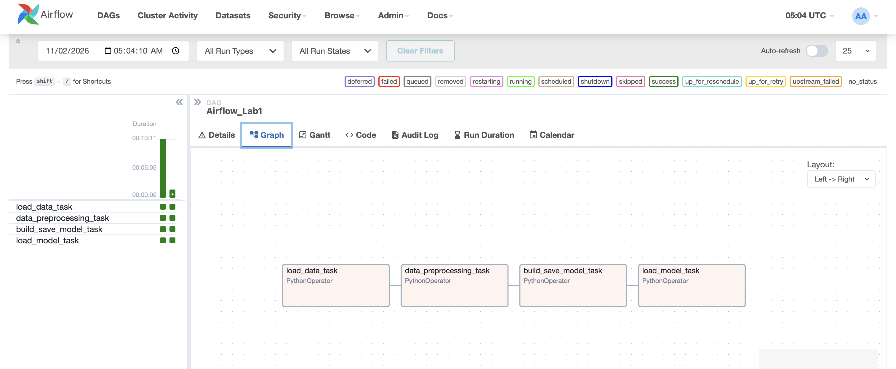
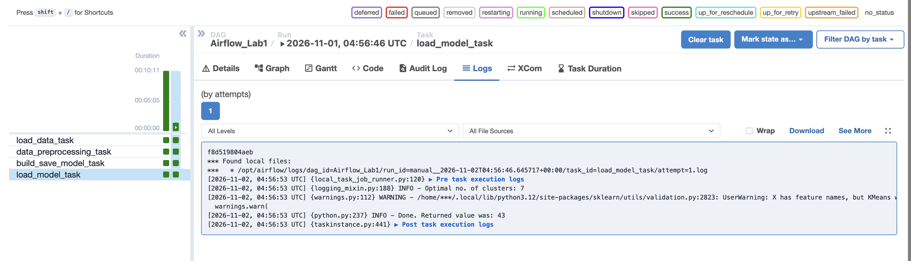

# Airflow Lab 1: House Price Segmentation with K-Means

An Apache Airflow pipeline, running in Docker, that groups houses from the Kaggle House Prices dataset into market segments with K-Means clustering, and picks the number of segments using the elbow method.

Based on [Airflow Lab 1](https://github.com/raminmohammadi/MLOps/tree/main/Labs/Airflow_Labs/Lab_1) from the MLOps course repo, which clusters credit-card customers. I swapped in a new dataset, reworked the preprocessing for it, and fixed the DAG so it loads on Airflow 2.9.2.

## Pipeline

```
load_data_task → data_preprocessing_task → build_save_model_task → load_model_task
```

| Task | What it does |
|---|---|
| `load_data_task` | Reads `dags/data/house_prices.csv` (1,460 houses, 81 columns) and passes it to the next task through XCom |
| `data_preprocessing_task` | Keeps 4 features: `GrLivArea` (living area, sq ft), `OverallQual` (quality 1–10), `YearBuilt`, `SalePrice`. Drops missing values and scales them to 0–1 with `MinMaxScaler` |
| `build_save_model_task` | Fits K-Means for k = 1…49, records the SSE (inertia) for each k, and saves the model to `dags/model/model.sav` |
| `load_model_task` | Loads the saved model, runs the elbow method (`kneed`) on the SSE curve, and assigns a cluster to the house in `dags/data/test.csv` |

## Result

The elbow method picks **7 house segments**. The full DAG run takes about 7 seconds.

**DAG run (all four tasks succeeded):**



**`load_model_task` log:**



## What I changed

### 1. Dataset
Replaced the credit-card dataset (`file.csv`, clustering on `BALANCE`, `PURCHASES`, `CREDIT_LIMIT`) with the [Kaggle House Prices](https://www.kaggle.com/c/house-prices-advanced-regression-techniques) training set (`train.csv`, downloaded through [OpenML #42165](https://www.openml.org/d/42165)), saved as `dags/data/house_prices.csv`.

### 2. Preprocessing (`dags/src/lab.py`)
- `load_data` reads `house_prices.csv` and treats `?` as missing, since that's how OpenML marks blanks.
- `data_preprocessing` selects the 4 house features **before** calling `dropna()`. The original called `dropna()` on the whole table first. In this dataset, columns like `PoolQC` and `Alley` are empty for almost every house, so that would have removed all 1,460 rows.

### 3. Test input (`dags/data/test.csv`)
Replaced it with one house that has the same 4 features: 1,500 sq ft, quality 6, built in 1995, sold for $180,000.

### 4. DAG fix (`dags/airflow.py`)
The course file imports `PythonOperator` from `airflow.providers.standard`, which only exists in Airflow 3. On the 2.9.2 image the DAG failed to load ("Broken DAG: No module named 'airflow.providers.standard'"). I switched it to the Airflow 2 import, `airflow.operators.python`.

### 5. Docker setup (`docker-compose.yaml`)
Started from the official Airflow 2.9.2 compose file, then:
- turned off example DAGs (`AIRFLOW__CORE__LOAD_EXAMPLES: 'false'`)
- installed `pandas scikit-learn kneed` in the containers
- added a `working_data` volume
- set a custom admin login

## Run it

Requires Docker Desktop with at least 4GB of memory.

```bash
echo -e "AIRFLOW_UID=$(id -u)" > .env      # Windows: AIRFLOW_UID=50000
mkdir -p logs plugins config
docker compose up airflow-init             # one-time database setup
docker compose up
```

Open http://localhost:8080 (login `airflow2` / `airflow2`), turn on `Airflow_Lab1` and trigger it. The number of segments is printed in the `load_model_task` logs.

Stop everything with `docker compose down`.

## Note
The cluster printed for the test house (`Returned value was: 43`) comes from the k=49 model the lab saves, applied to unscaled test values, so that number isn't meaningful. The elbow result is the pipeline's main output.
